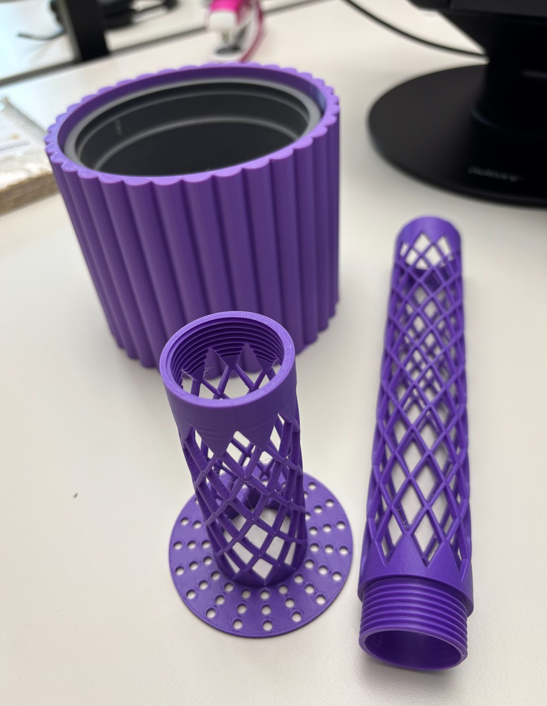

::: {.grid}

::: {.g-col-12 .g-col-lg-6}

:::

::: {.g-col-12 .g-col-lg-6}

DESIGNED AND PRINTED BY GINA THE DUCKY

# Made to grow with your plant.

A modular moss pole system for climbing plants such as Monstera, with a matching decorative pot that fits a standard inlay. Add another section when your plant gets taller. Keep the base, keep growing.

taglines:
- expandable
- matching pot
- screw-together
- easy to print



:::

:::

----------------------------------------------------

::: {.grid}

::: {.g-col-12 .g-col-lg-6}
# How it works.

01 Start with a steady base: The wide, perforates anchor sits inside the soil to help prevent the pole from tipping as your plant climbs.

02 Screw the sections together: Integrated threads connect each pole section. Add extensions on top as your plant grows, without replacing the whole pole.

03 Five it a matching home: The decorative ribbed pot holds a standard inlay and completes the set. 

:::

::: {.g-col-12 .g-col-lg-6}
Project details

- Components: Decorative pot, soil anchor, pole extension
- Material: PLA or PETG
- Supports: Not required
- Other materials: Not required
- Assembly: Integrated screw thread

License & attribution
:::

:::
