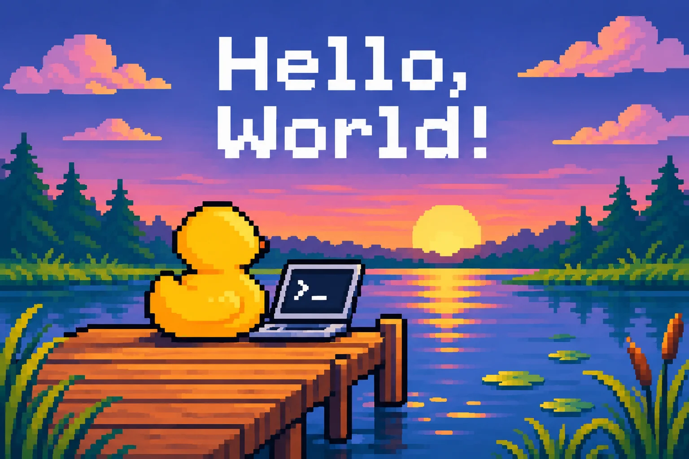

I know blogs are a bit out of date in 2026. They probably were in 2020. But here I am. Writing one.

Because I've always wanted to have one, but never got around to it. Or I always thought nobody would care about what I had to say. Maybe I'm old enough now that this doesn't bother me anymore. Even if nobody ever visits this blog, I'm writing it for myself. Because I enjoy writing, because I wanted to learn how to build a blog, and because it's fun.

Part of the reason I never started a blog is that everything out there looked so polished, so perfect. And I thought I could never put anything less than that out there.

But then I read something in my favorite magazine, The MagPi (now Raspberry Pi Official Magazine), that stuck with me: the main thing about a maker project is to make it work. Then make it pretty.

And I realized I wanted to make stuff, even if it didn't look perfect right from the start. All those beautiful, brilliant maker videos you see out there — at some point, they all started at zero. Because nobody is perfect at something right from the start. Everybody has to learn.

So maybe the same should apply to this blog. Make it work first. Make it pretty later.

And that's exactly what I want to do here. Learn, experiment, and document the process.

Most of my projects involve 3D printing, electronics, or coding. Sometimes all three. I also have a habit of starting new projects before finishing the old ones.

This blog is my digital maker notebook. A place to collect ideas, document experiments, share what worked (and what definitely didn't), and leave a few notes for my future self.

Expect experiments, questionable design decisions, and the occasional happy accident.

And why The Digital Duck Pond? Well, I collect rubber ducks, I like computers, and apparently I needed a name for this whole thing. It seemed appropriate.

Let's see where this goes.

`> status: initialized_`