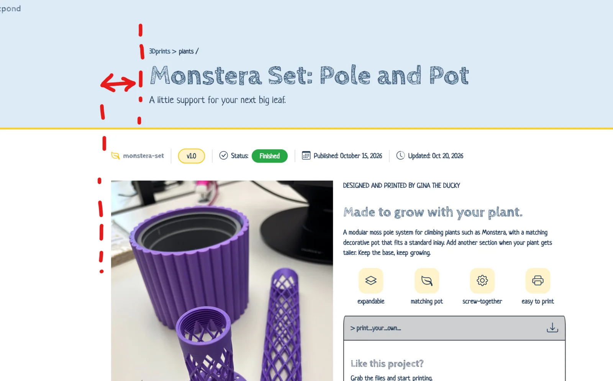

## The problem: A banner that wouldn't line up

While building my website, *The Digital Duck Pond*, I wanted to give different sections their own custom title banners.

For example, my regular pages have a simple banner with a title, description, and a small eyebrow label above the title. My 3D-printing projects have their own banner design, with project-specific information and styling.

I created these banners using custom HTML title-block templates in Quarto.

Everything worked nicely, except for one annoying detail: **the text inside my banners didn't line up with the content underneath.**

See here:



I was using Quarto's `page-layout: full`, which gives the main article more horizontal space when there are no sidebars or margin elements occupying that space.

My article content was nicely centered on the page, but the banner text started much farther to the left.

What I wanted was simple:

- The banner background should stretch across the entire page.
- The text inside the banner should start at exactly the same position as the article content.
- The alignment should adapt automatically to different screen sizes.
- I didn't want to hardcode widths or margins that might break when I changed my layout.

It sounded like a simple CSS problem. As it turned out, the solution was simple too — once I understood how Quarto handles page layouts.

## My first attempt: Bootstrap columns

Since Quarto's HTML output uses Bootstrap, my first idea was to use Bootstrap's grid system.

I tried something like this:

```html
<header class="page-banner">
  <div class="quarto-title">
    <div class="row justify-content-center">
      <div class="col-md-8">
        <h1>My Page Title</h1>
        <p>My page description</p>
      </div>
    </div>
  </div>
</header>
```

If you've used Bootstrap before, this probably looks reasonable.

The `row` creates a flex container, `justify-content-center` centers its columns, and `col-md-8` gives the content a width of eight out of twelve grid columns on medium-sized screens and larger.

The problem is that **Bootstrap's grid is not the same as Quarto's page layout grid.**

Even if Bootstrap centers the content correctly, that doesn't mean it will line up with the article below.

The article width is determined by Quarto's layout system, while my banner was using a separate Bootstrap layout.

I needed a way to make both use the same positioning rules.

## Understanding Quarto's page layout

Quarto provides several page layouts, including `article`, `full`, and `custom`.

For my website, I'm using:

```yaml
format:
  html:
    page-layout: full
```

According to [Quarto's page layout documentation](https://quarto.org/docs/output-formats/page-layout.html), the `full` layout uses the article grid system but expands the available content area when the sidebar and margin regions aren't occupied.

This was the important clue.

My article wasn't simply centered using `margin: auto`. Quarto was positioning it inside a **CSS Grid with named grid lines**.

### What are named grid lines?

CSS Grid allows us to divide a container into columns and rows. Normally, we can position elements using numbered grid lines.

But CSS Grid also supports *named* grid lines.

For example:

```css
.my-grid {
  display: grid;
  grid-template-columns:
    [left-edge] 1fr
    [content-start] 800px
    [content-end] 1fr
    [right-edge];
}
```

We can then position an element using those names:

```css
.my-content {
  grid-column: content-start / content-end;
}
```

This tells the browser to place the element between the grid lines named `content-start` and `content-end`.

Quarto uses a more sophisticated version of this idea.

Its layout grid includes named boundaries such as:

- `screen-start` and `screen-end` for the screen region.
- `page-start` and `page-end` for the page region.
- `body-content-start` and `body-content-end` for the narrower body content region.

The exact sizes of these regions depend on the page layout and available space.

This is what allows Quarto to arrange content, sidebars, margin elements, and full-width sections responsively.

## Finding out what Quarto was doing

To understand why my banner wasn't aligned, I opened my website in Chrome and used Developer Tools.

You can do the same by right-clicking an element and choosing **Inspect**.

I selected the main article element and found this HTML:

```html
<main
  class="content column-page"
  id="quarto-document-content">
```

The interesting class here is `column-page`.

In the **Computed** tab, I found that Quarto positioned the article using:

```css
grid-column-start: page-start;
grid-column-end: page-end;
```

In other words, the article was occupying the grid region between `page-start` and `page-end`.

That was exactly the region I wanted my banner text to occupy.

I also inspected the article's parent container:

```html
<div
  id="quarto-content"
  class="quarto-container page-columns
         page-rows-contents page-layout-full">
```

The `page-columns` class was another important discovery. It provides the grid layout used to position the article.

My custom banner didn't initially have the same setup.

## The solution: Reusing Quarto's grid

Instead of trying to reproduce Quarto's widths using Bootstrap or manually calculated margins, I decided to use Quarto's own grid system.

My final banner structure looks like this:

```html
<header
  id="title-block-header"
  class="quarto-title-block default page-banner page-columns">
  <div class="page-banner-content">
    <div class="quarto-title">

      $if(banner.eyebrow)$
      <p class="page-banner-eyebrow mb-2">
        &gt; $banner.eyebrow$
      </p>
      $endif$

      $if(title)$
      <h1 class="title display-3 fw-bold">
        $title$
      </h1>
      $endif$

      $if(description)$
      <div class="description">
        $description$
      </div>
      $endif$
      
    </div>
  </div>
</header>
```

This is the HTML template I use for my regular page banners.

The `$if(...)$` and `$...$` expressions are Pandoc template syntax, which Quarto uses to insert metadata into custom templates.

For example, `$title$` inserts the page title, while `$if(description)$` only renders the description block if that metadata exists.

Those template expressions aren't important for the alignment itself. The relevant parts are the HTML classes.

### Step 1: Make the header use Quarto's grid

The first important class is `page-columns`:

```html
<header class="page-banner page-columns">
```

This allows the header to use Quarto's page grid.

In my setup, the class provides a grid with the named lines I need.

Notice that I put `page-columns` directly on the header, rather than creating a second nested grid inside it.

That distinction matters because nested grids don't automatically inherit their parent's column tracks.

### Step 2: Add a content wrapper

Next, I added a wrapper around the banner's content:

```html
<div class="page-banner-content">
  <!-- Title, description, etc. -->
</div>
```

`page-banner-content` is a custom class I created. It isn't a special Quarto class.

Its purpose is to give me an element I can position within the grid.

It's also a direct child of the header, which is important because CSS Grid positions the direct children of a grid container.

### Step 3: Place the content in the correct grid region

Finally, the CSS that solved the problem:

```scss
/*
 * Aligns the banner content with Quarto's main article content.
 *
 * Quarto uses a CSS grid with named column boundaries.
 * The 'page-start' and 'page-end' lines define the page region
 * used by the article in my full-width layout.
 *
 * The banner background can remain full-width while the text
 * follows the same responsive alignment as the article.
 */
.page-banner-content {
  grid-column: page-start / page-end;
}
```

That's it!

The `grid-column` property tells the browser to position `.page-banner-content` between Quarto's `page-start` and `page-end` grid lines.

Since my article also occupies that region, the banner text now lines up with the article content.

No hardcoded width. No manually calculated margins. No Bootstrap columns.

And because the positioning uses Quarto's grid, the alignment adjusts as the layout changes.

## Which classes actually matter?

My banner contains several classes, but they have different responsibilities.

| Class | Purpose |
|---|---|
| `page-columns` | Enables Quarto's page grid on the header |
| `page-banner-content` | Custom wrapper positioned within that grid |
| `page-banner` | Custom class for the banner's background, padding, and other styling |
| `quarto-title-block` | Quarto title-block styling hook |
| `default` | Default title-block styling hook |
| `quarto-title` | Quarto's title container |
| `display-3` | Bootstrap's large display heading |
| `fw-bold` | Bootstrap's bold font weight |
| `mb-2` | Bootstrap's bottom-margin utility |

For the alignment itself, the essential combination is:

```html
<header class="page-columns">
  <div class="page-banner-content">
    ...
  </div>
</header>
```

Together with:

```css
.page-banner-content {
  grid-column: page-start / page-end;
}
```

The other classes handle the appearance of the banner and its text.

One thing worth mentioning: this works because my banner's grid has the same relevant page-region boundaries as the article grid. If you're using a different Quarto layout or custom CSS, it's worth inspecting both grids to make sure they match.

## Why not just use a fixed maximum width?

Another possible solution would have been:

```css
.page-banner-content {
  max-width: 1100px;
  margin-inline: auto;
}
```

That would certainly center the banner content.

But it would introduce a separate width that I would have to maintain.

If I changed my Quarto layout, adjusted the page width, or switched to a different screen size, the banner might no longer align with the article.

By using `page-start / page-end`, I'm telling the banner to follow the page region defined by Quarto itself.

That's a much better fit for what I wanted.

## Using the same approach for different banners

One nice thing about this solution is that it isn't limited to a single banner design.

On my website, I have different title banners for regular pages and 3D-printing projects.

They don't necessarily contain the same information. One might show a title and description, while another might include categories, project information, or other metadata.

But both need the same horizontal alignment.

So I can give them different styling while reusing the same layout principle.

For example:

```html
<header class="page-banner page-columns">
  <div class="page-banner-content">
    <!-- Regular page banner -->
  </div>
</header>
```

And:

```html
<header class="print-banner page-columns">
  <div class="print-banner-content">
    <!-- 3D printing project banner -->
  </div>
</header>
```

With:

```scss
.page-banner-content,
.print-banner-content {
  grid-column: page-start / page-end;
}
```

Each banner can have its own background, typography, spacing, and decorative elements, while the content stays aligned with the article below.

## A small debugging tip

If you're trying this and your banner still doesn't line up, Chrome's Developer Tools are your friend.

Inspect the article and look for its computed `grid-column-start` and `grid-column-end` values.

Then inspect the grid container and check its `grid-template-columns` property.

Finally, compare those values with your banner's grid.

It's especially worth checking whether the article and banner are actually using equivalent grid definitions. Having a `page-columns` class doesn't automatically guarantee identical positioning in every Quarto configuration.

Also, be careful when experimenting with Quarto's built-in classes. During my attempts, I tried different combinations of `column-body`, `column-page`, and nested `page-columns` containers. Some didn't give the alignment I wanted, and one even changed the article layout.

Inspecting the actual grid was much more useful than guessing which class might work.

## Final thoughts

What started as a small alignment problem turned into a useful lesson about how Quarto builds its HTML layouts.

The key discovery was that **Quarto already had the positioning system I needed**. I just had to use it in my custom banner.

Rather than fighting the layout with Bootstrap columns or fixed margins, I could reuse Quarto's named CSS Grid lines.

And in the end, the essential CSS was just one line:

```css
grid-column: page-start / page-end;
```

Sometimes the nicest CSS solution isn't adding more rules. It's understanding the ones that are already there.

### Further reading

- [Quarto: Page Layout](https://quarto.org/docs/output-formats/page-layout.html)
- [Quarto: HTML Templates](https://quarto.org/docs/output-formats/html-basics.html#templates)
- [MDN: CSS Grid Layout](https://developer.mozilla.org/en-US/docs/Web/CSS/CSS_grid_layout)
- [MDN: grid-column](https://developer.mozilla.org/en-US/docs/Web/CSS/grid-column)