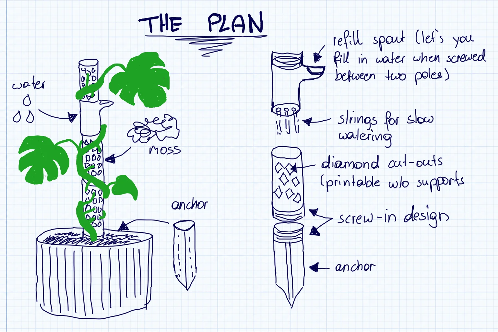

The plan is to build a modular moss pole system that gives my Monstera something to climb while keeping the moss moist. Ideally, without me having to water it constantly.

The system will consist of three main parts: a soil anchor to keep everything stable, stackable moss pole sections, and a watering reservoir.

The idea is to fill the reservoir with water and let it slowly drip into the moss. Small holes at the bottom will hold cotton threads that should transport the water into the moss through capillary action.

At least, that's the theory. We'll see how well it works in practice.

> open_question_
Will the cotton threads actually deliver enough water to keep the moss moist? And how evenly will the water spread?

For the moss pole itself, I'm planning to use a diamond-shaped lattice pattern. Apart from looking quite nice, the angled openings should make it possible to print the pole without supports. And I'd really like to keep this as easy to print as possible.

I'm also designing the system parametrically in Fusion 360, so I can change the diameter of the pole without having to redesign everything.

> next_iteration_
Finish the first prototype, print the parts.