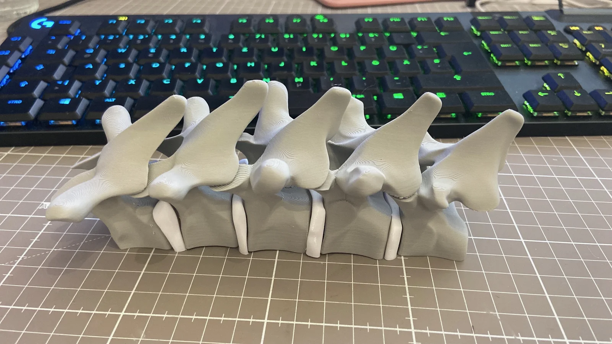
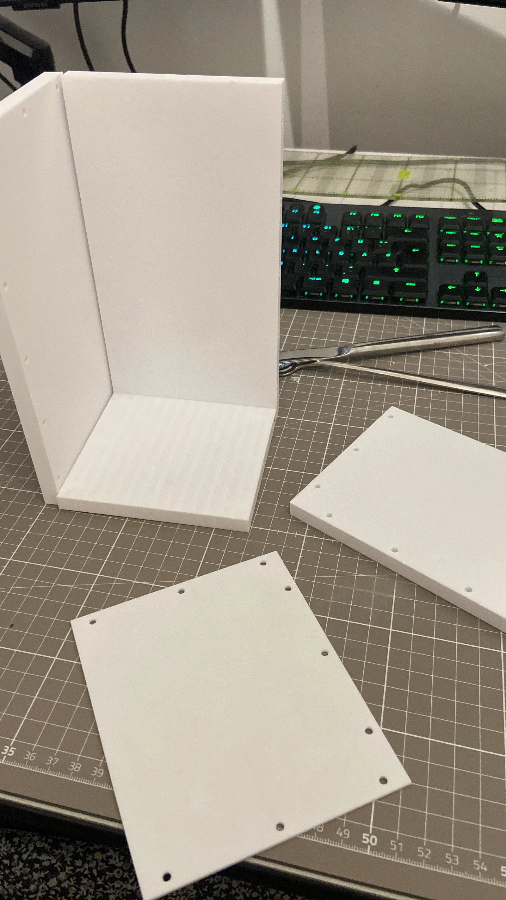
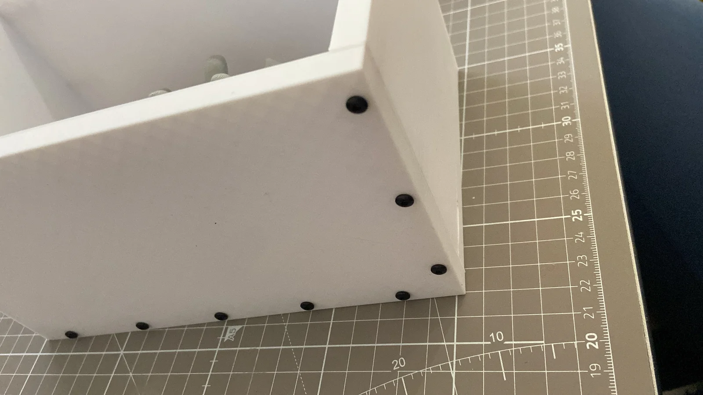
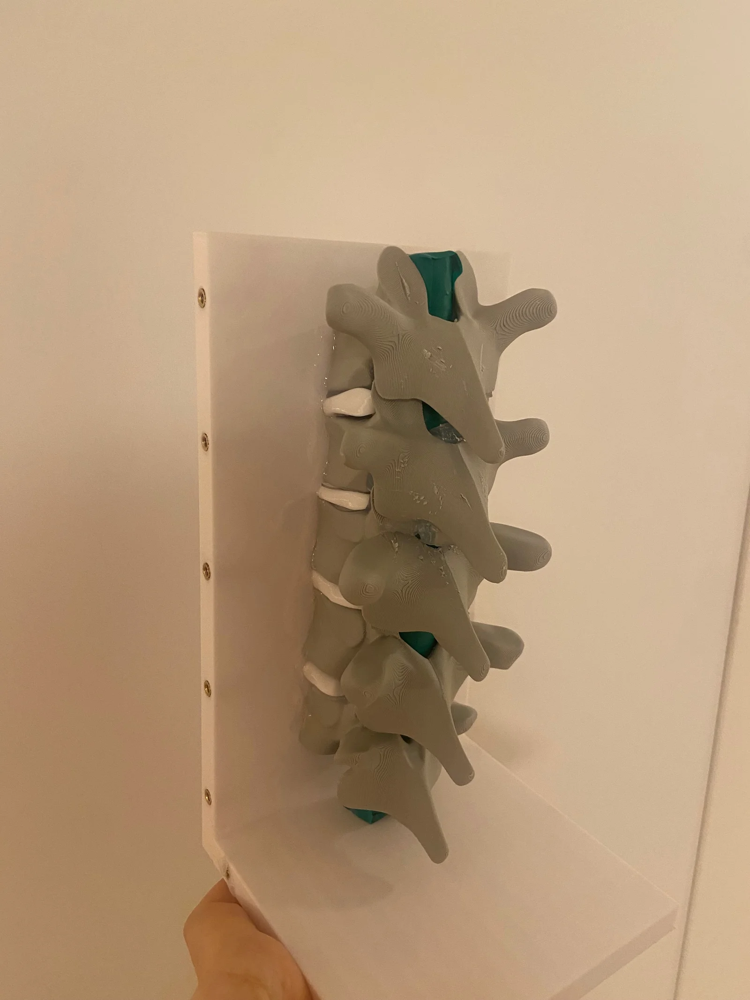
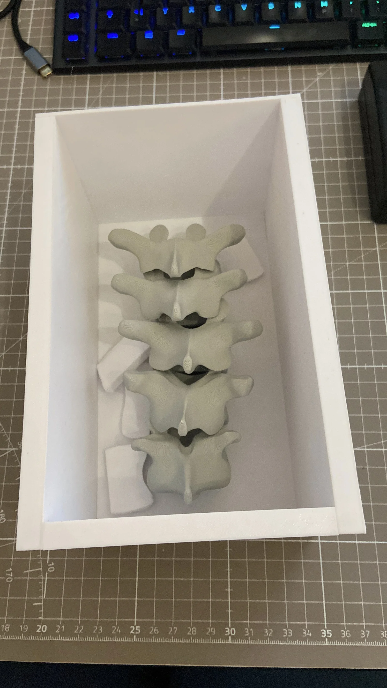
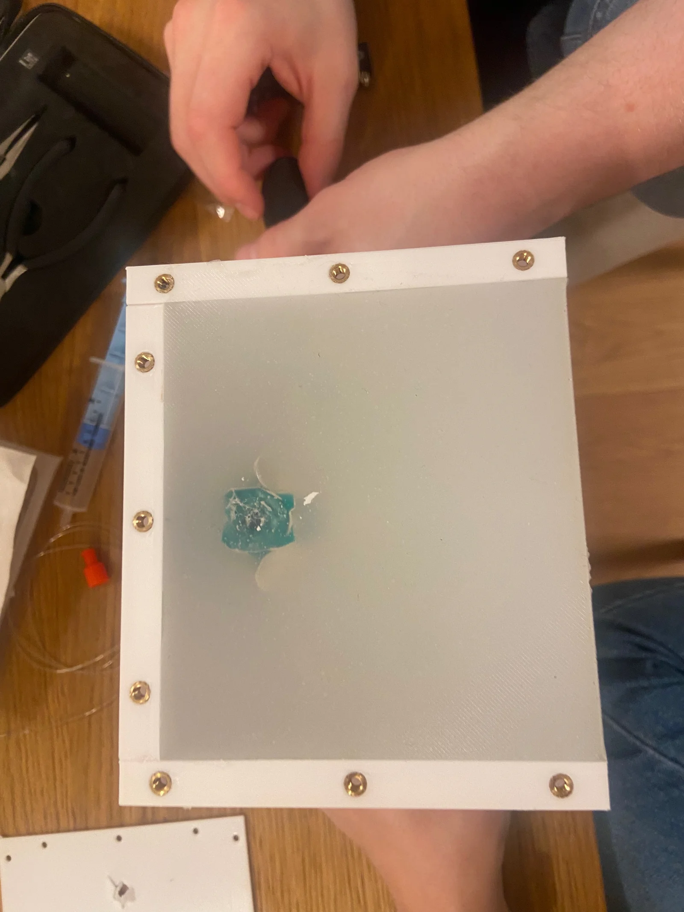
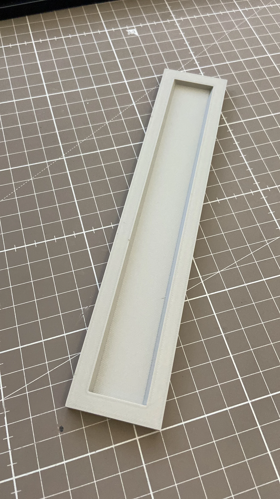

### Making the Original

A while ago, a friend of mine (who happens to be a doctor) sent me [this paper](https://pmc.ncbi.nlm.nih.gov/articles/PMC7065759/) about a 3D-printed thoracic epidural training model and asked if we could make one ourselves. The authors even provided the [STL files on GitHub](https://github.com/aport6/thoracic-epidural-model/), so naturally, we had to try it.

The original files included the spine model, but we also needed something to hold everything together while pouring the silicone. So I designed a simple 3D-printed enclosure that would hold the spine in position and act as a mold for the silicone. I made it from several flat panels that could be screwed together, with heat-set inserts to make assembly and disassembly easier. The idea was to place the printed spine inside, pour silicone around it, let it cure, and then remove the panels to get our finished training model.

We printed it, assembled it, tested it, and it actually worked! I even got to try giving the dummy spine an epidural myself. So, in the unlikely event of a zombie apocalypse where all the doctors have disappeared, I might consider giving it a go. (Please don't take that as a medical qualification.)

:::{.duck-carousel}

:::

Now, a few months later, my friend asked if we could make several more models for a training session. That seemed like a good excuse to revisit the design and make it **easier, cheaper, and more reproducible**.

### Possible improvements

The original design works, but there are a few things I'd like to improve:

- **No more heat-set inserts and screws.** They make assembly unnecessarily complicated, especially when building multiple models.
- **Print the spine in one go.** Instead of assembling separate parts, I'd like to see if we can print the whole thing as one piece.
- **Use less silicone.** The chamber holding the spine is quite large. Maybe we can make it smaller without compromising its function.

The plan is to redesign the parts, test the changes, and eventually share the files and instructions on GitHub so others can build their own.

And apologies to any medical professionals reading this for repeatedly referring to a rather complicated anatomical structure as *the spine thingy* in my head.

**Let's see if we can make version 2 a little more assembly-friendly!**

> **> open_question_**
> Can I print the entire spine as one piece while keeping it functional? And how much can I shrink the chamber before it becomes impractical? Also can I print the enclosure in one piece so no assembly is required? Ideally no tools should be needed.
