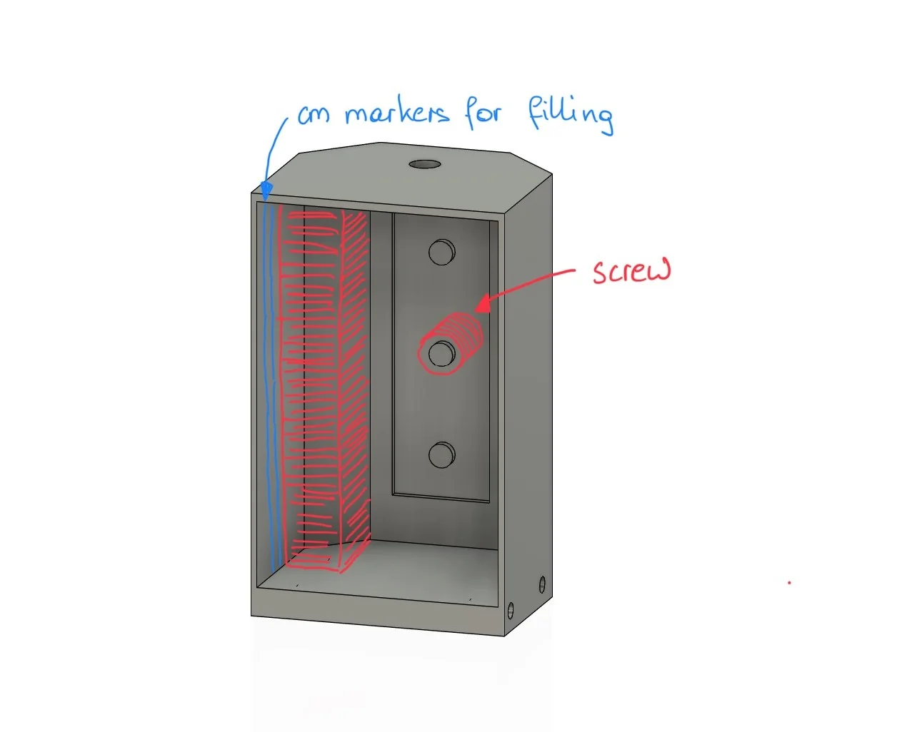
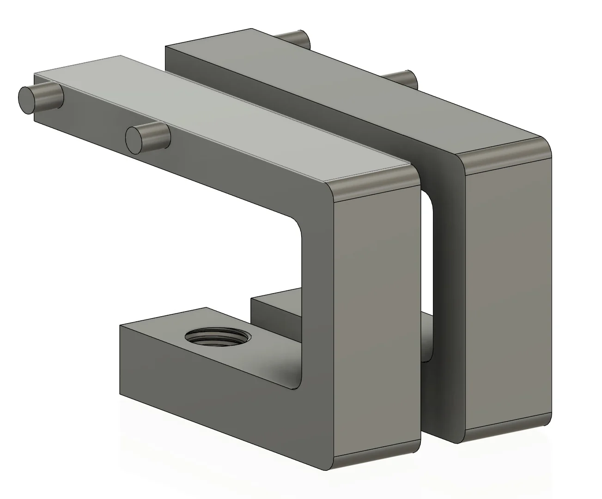
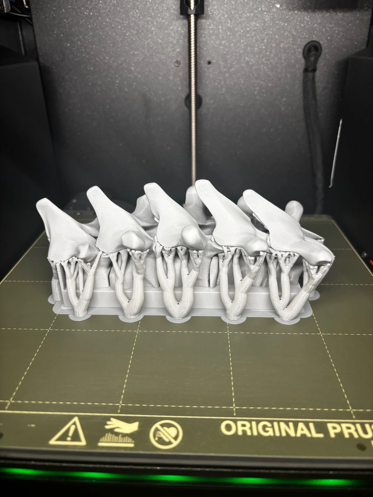
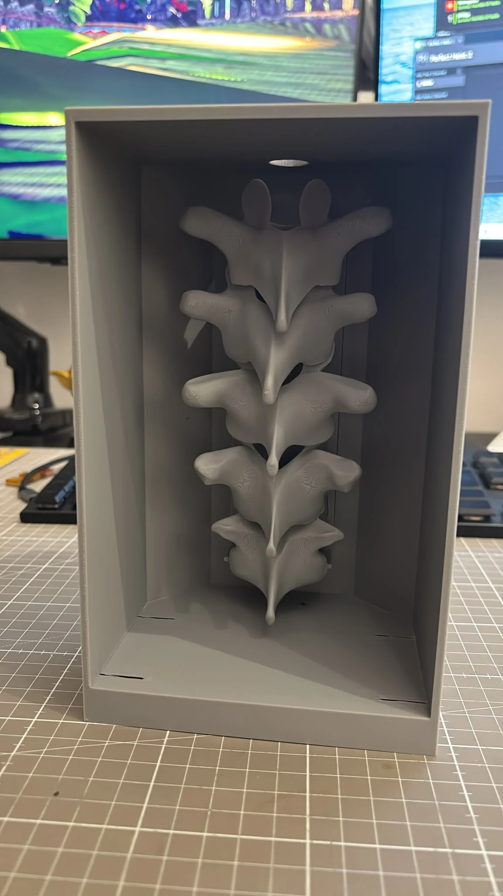
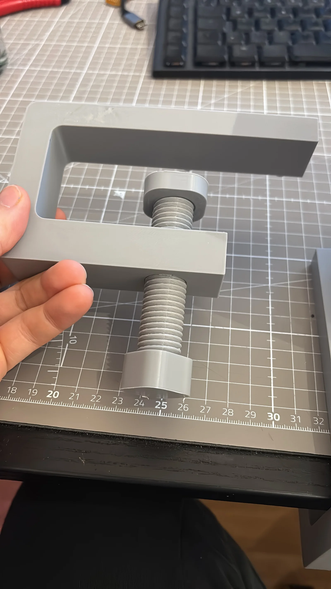
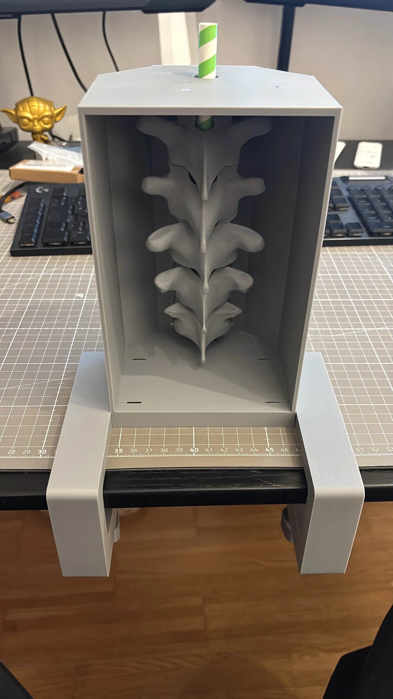

The goal was to make the epidural training model easier to print and assemble, especially since we eventually want to make several of them.

:::{.duck-carousel}

:::

### A new enclosure

First, I redesigned the enclosure. Instead of printing several panels and assembling them with screws and heat-set inserts, the new box prints as a single piece in PLA. No assembly required!

I also made the box a bit more compact to reduce the amount of filament (and hopefully silicone) needed.

### Printing the spine in one piece

Next up was the spine itself. The original model required some assembly, so I wanted to see if I could print the whole thing in one go.

I added a back section to the spine model, essentially capping it off, and designed an insert that fits into a matching slot inside the enclosure. This keeps the spine in a fixed position and, more importantly, aligns the spinal canal with the hole at the top of the box.

The first print needed quite a bit of support material, but it worked! Removing all those supports was a bit of an adventure, though.

### Keeping everything in place

I also designed a pair of simple 3D-printed desk clamps. They use printed threads and screws to secure the enclosure to the edge of a table.

The idea is to keep the training model from moving around while someone practices on it. The clamps are removable, so the model can still be transported and stored easily. And the clamps can be re-printed if they break or get lost.

