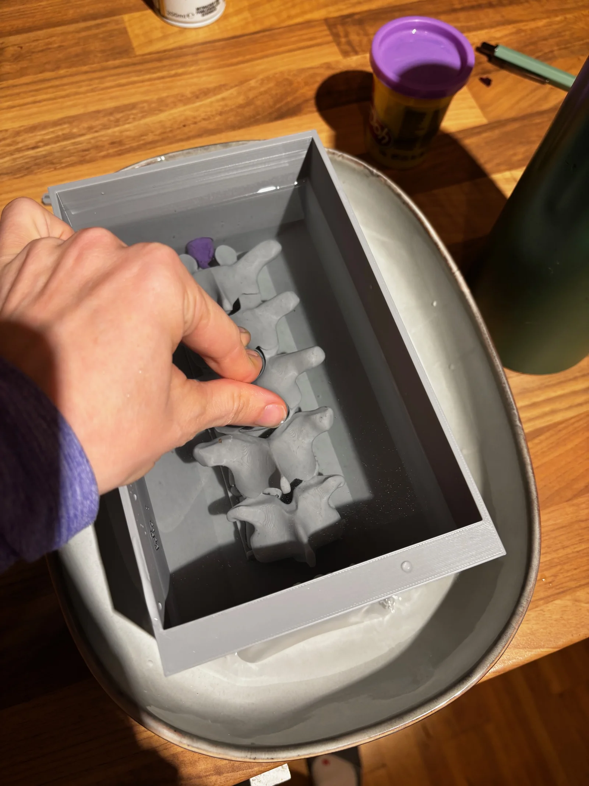

Time for a little experiment! Before wasting a lot of silicone (or gelatine), I decided to fill the enclosure with water to see if everything would stay in place.

I sealed the hole at the top of the box with some modelling clay (Plastilin). It wasn't completely watertight, but that was expected. For the actual silicone or gelatine casting, some tape should hopefully do the trick.

However, the water test revealed a slightly bigger problem: the spine floats!

Because the spine is 3D-printed with infill, it contains trapped air, making it buoyant. The insert I designed keeps the spine in the correct position, but it doesn't stop it from floating upwards once the enclosure is filled with liquid.

So, back to the drawing board. I need something that actually holds the spine in place. I could just glue it to the enclosure, but that would make removing it pretty much impossible. And since I want the model to be reusable, I'd like to be able to take the spine out for cleaning, especially when using gelatine.

I'm thinking some sort of screw mechanism might do the trick. Something that holds the spine securely during casting but can easily be undone afterwards.

For this version, superglueing the spine in place works, but most likely I won't be able to remove the spine from the box again. Even with just a little drop of superglue.

> **> note_for_next_version**
> Design some kind of screw mechanism to hold the spine in place.
