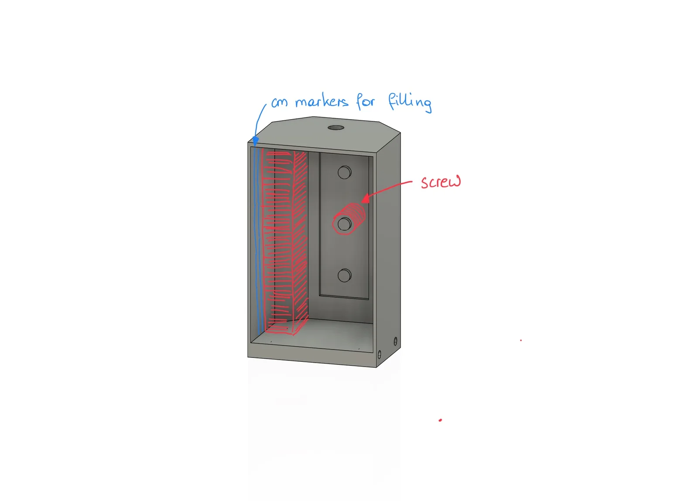
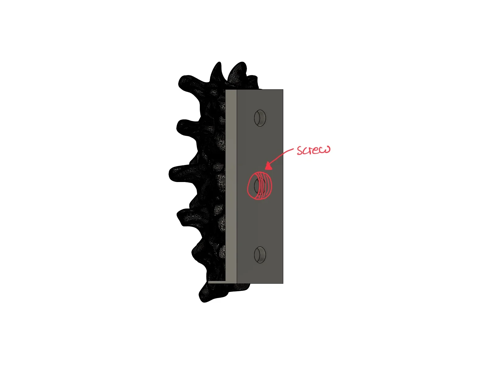

After the floating spine experiment, I have a few ideas for improving the design.

:::{.duck-carousel}

:::

First, I want to make the enclosure a bit narrower by adding a recessed section along one side. This pocket should extend exactly to the highest point of the spine, so I can use it as a reference when filling the box. I'll also add 1 cm markings along the pocket to make it easier to measure the filling level and get consistent results.

And, of course, I still need to solve the floating spine problem. My plan is to add a simple screw mechanism to secure the spine to the back of the enclosure. That should keep it from floating upwards while still allowing me to remove it for cleaning.

Hopefully, these changes will make the model easier to fill, more reproducible, and a little less determined to float away!